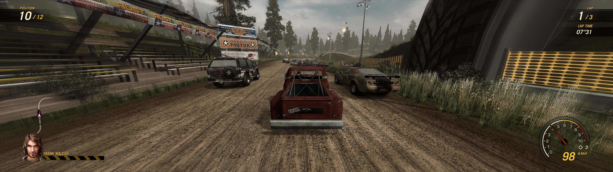

# FOUC Ultrawide

Proper ultrawide support (21:9, 32:9 and anything wider than 16:9) for **FlatOut: Ultimate Carnage — Collector's Edition** on Steam.
It's a single ASI plugin: the 3D view becomes Hor+, and every menu, HUD element, dialog and video keeps its correct proportions instead of being stretched.

Also on Steam: [FOUC Ultrawide guide](https://steamcommunity.com/sharedfiles/filedetails/?id=3844778000).



## Features

- **Hor+ 3D camera.** The view widens with the screen instead of being stretched or cropped. The sky dome is corrected too.
- **Automatic aspect ratio.** The aspect is calculated from the selected resolution, whatever the game's own "Aspect ratio" setting says.
- **Configuration tool.** Resolutions are labelled with their real aspect (e.g. `5120 x 1440  (32:9)`), and the Aspect ratio list has 21:9 and 32:9 entries that are selected automatically.
- **Menus.** The 640×480 menu layout is spread across the full width with correct proportions: Lua GUI elements, text, selected-option labels, sliders and button prompts.
- **Now-playing music bar** (menus and races).
- **Dialogs.** The main-menu message boxes and all in-race confirmation boxes (Retry race, Quit, ...): box, text and arrows.
- **Loading screens.** The 16:9 artwork has black bars at the sides, and its text keeps the correct width.
- **In-race UI.** Pause menu, countdown, finish screens and replay HUD.
- **Full-screen videos.** Intro logos and the trailer fit the screen height (black bars at the sides) instead of being cropped at the top and bottom.

## Requirements

- FlatOut: Ultimate Carnage Collector's Edition (Steam), with the original `Fouc.exe` of **4,242,504 bytes**. With any other exe the plugin shows a warning and disables itself.

## Installation

1. Download the latest `FOUCUltrawide-vX.Y.zip` from the [Releases](../../releases) page.
2. Extract it into the game folder, e.g. `C:\Program Files (x86)\Steam\steamapps\common\FlatOut Ultimate Carnage\`. You should end up with:
   ```
   FlatOut Ultimate Carnage\winmm.dll
   FlatOut Ultimate Carnage\scripts\FOUCUltrawide.asi
   ```
3. Pick your monitor's native resolution in the game's configuration tool: in Steam press **Play** and choose **Launch configuration tool**. It also opens on the very first launch.
   - The aspect ratio is selected automatically, and the plugin uses the resolution's real aspect in game either way.
4. Start the game.

### Upgrading from v1.0

v1.0 shipped the loader as `dinput8.dll`. Delete that file when installing a newer version, otherwise the plugin is loaded twice.

### Uninstall

Delete `winmm.dll` and `scripts\FOUCUltrawide.asi` from the game folder.

## Building from source

You need a 32-bit (i686) MinGW-w64 GCC toolchain, e.g. the i686 build from [WinLibs](https://winlibs.com/).

```powershell
.\build.ps1 -Gxx "C:\path\to\mingw32\bin\g++.exe"
```

The output is `build\FOUCUltrawide.asi`. The plugin source is in `src/main.cpp`; `src/memory.h` has the small memory-patching helpers it uses.

## How it works

The game lays out all 2D elements in a virtual 640×480 space and scales it to the screen with `resX / 640` horizontally and `resY / 480` vertically. Wider than 4:3, everything gets stretched horizontally.

The plugin redirects those `640` / `320` constants to values computed from the real aspect ratio. The virtual width becomes `480 × aspect` (1706.7 at 32:9), so the horizontal and vertical scales are equal and elements are re-centred around the new middle of the screen.

During races, HUD text is narrowed glyph-by-glyph instead. Elements that already use the uniform scale (the music bar, confirmation dialogs, loading-screen text) are excluded from that narrowing so they aren't corrected twice.

| Area | Where (Fouc.exe) | What changes |
|---|---|---|
| Aspect ratio | `0x45747F` | Aspect pair handed to the renderer is replaced with `resX/resY` |
| Configuration tool | `0x45642F`, `0x455C80`, `0x456066`, `0x457422` | 21:9 / 32:9 entries, labels and auto-selection |
| 3D camera / sky | `0x4F44F6`, `0x591FA5` | Frustum widened by `aspect / (16/9)` (Hor+) |
| Menu layout & Lua GUI | `0x5EC90D`, `0x5F8532`, `0x5ED0AF`, `0x5ED2F4`, Lua aspect references | Re-centring and uniform sprite/text scale |
| Menu text & prompts | `0x4CAF6E`, `0x4CF39B`, `0x5F08C7`, `0x4CB242` | Uniform scale and spacing |
| In-race HUD text | `0x5A9130` / `0x5A9979` | Per-glyph width correction |
| Music bar | `0x46D1C8`, call at `0x46C8B9` | Uniform scale |
| Main-menu message box | `0x4CE130` | Uniform scale, centred box and text |
| In-race confirmation boxes | `0x4BE8E8` section + vtable slots `0x6E7918`, `0x6E7940`, `0x6E79FC`, `0x6E7A20` | Uniform scale for box, text and arrows |
| Pause / finish screens | `0x4AB421`, `0x4B11BC`, `0x4B3F60`, ... | Uniform widths and centres |
| Loading screen | `0x564350` | 16:9 artwork with side bars |
| Videos | call at `0x4FA8DF` | Fit to height, centred |

## Credits

- [ThirteenAG](https://github.com/ThirteenAG/Ultimate-ASI-Loader) for **Ultimate ASI Loader** (`winmm.dll` in the release), which loads the plugin.

## License

[Mozilla Public License 2.0](LICENSE).
